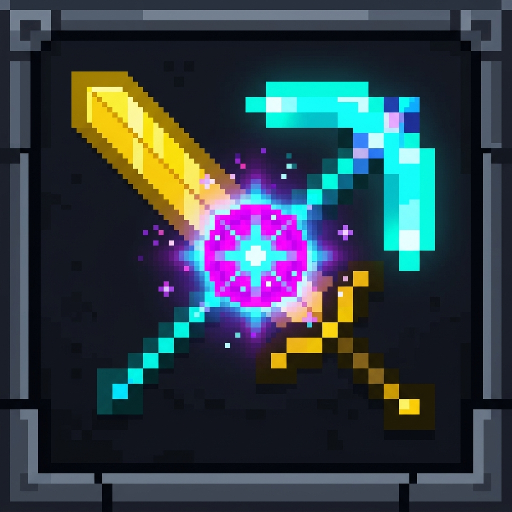

<div align="center">
  

# ✨ Skills - Modern RPG Skills & Stats for Minecraft

[](https://www.oracle.com/java/)
[](https://papermc.io/)
[](https://www.minecraft.net/)
[](https://github.com/lino9999/Skills/releases)
[](https://github.com/lino9999)
</div>

**Skills** is a lightweight, ultra-optimized, modular RPG skill and leveling engine for modern Minecraft servers. Built from scratch for **Paper**, **Spigot**, and **Folia**, Skills delivers an engaging progression system without bloated external dependencies or performance overhead.

---

## ⚡ Highlights

- 🚀 **Zero Dependency Bloat**: Unlike legacy plugins, Skills runs completely standalone without requiring heavy proprietary core libraries.
- ⚡ **Folia Native & Multi-Threaded**: Built with asynchronous regional scheduling, thread-safe SQLite storage, and zero main-thread lag.
- 🎯 **9 Core Skills**: Mining, Woodcutting, Farming, Combat, Armory, Fishing, Alchemy, Enchanting, and Exploration.
- 🛡️ **9 Dynamic Stats**: Health, Defense, Strength, Speed, Crit Chance, Crit Damage, Ferocity, Wisdom, and Attack Speed. Real-time attribute modifiers applied instantly.
- 🔮 **26 Powerful Passive Effects**: Spelunking, Bountiful Harvest, Master Lumberjack, Dodging, Bleed strikes, Nausea dazzle, Haste bursts, Durability auto-repairs, and more.
- 🌊 **Magic & Mana System**: Fully configurable mana pool, passive regeneration, and mana-cost integration.
- 📊 **Persistent HUD Action Bar**: Clean, customizable actionbar display showing real-time health, defense, strength, speed, and mana.
- 💥 **Modern Floating Damage Numbers**: Crisp holographic damage and crit indicators using lightweight `TextDisplay` entities.
- 📱 **Interactive Chest GUIs**:
  - `/skills` - Main overview menu with player statistics head and 9 skill cards with progress bars.
  - `/stats` - Comprehensive stat breakdown.
  - `/skills -> [Skill]` - 50-level progression pathway menu with unlocked, in-progress, and locked visual states.
- 🔌 **PlaceholderAPI Integration**: Native built-in support for all `%skills_*%` placeholders across scoreboards, tablists, and menus!

---

## 📜 Skills Overview

| Skill | Primary Trigger | Key Rewards & Effects |
|---|---|---|
| **⛏️ Mining** | Mining stone, ores, deepslate | Defense, Ferocity, Versatile Tools, Spelunking, Dynamic Mining |
| **🪓 Woodcutting** | Chopping logs and trees | Strength, Master Lumberjack, Overcompensation |
| **🌾 Farming** | Harvesting mature crops | Health, Wisdom, Bountiful Harvest, Golden Yield, Satiation |
| **⚔️ Combat** | Slaying hostile mobs and monsters | Strength, Ferocity, Serrated Strikes (Bleed), Dazzle, Strong Impact |
| **🛡️ Armory** | Taking damage, wearing armor | Health, Defense, Bravery, Mystic Resilience, Infernal Resistance |
| **🎣 Fishing** | Catching fish and oceanic treasures | Wisdom, Eye of the Depths, Magnetic Rod |
| **🧪 Alchemy** | Brewing potions at brewing stands | Wisdom, Efficient Brewing, Potionmaster |
| **✨ Enchanting** | Enchanting gear & books | Wisdom, Reimbursement (XP refund), Overcompensation (Lapis refund) |
| **🧭 Exploration** | Walking, running, swimming, flying | Speed, Health, Accelerated Escape, Seamless Movement |

---

## 🎮 Commands & Aliases

### Player Commands
| Command | Aliases | Description | Permission |
|---|---|---|---|
| `/skills` | `/skill`, `/sk`, `/professions` | Opens the main interactive Skills Overview menu | `skills.menu` |
| `/stats` | `/stat`, `/st`, `/attributes` | Opens your personal RPG Attributes menu | `skills.stats` |
| `/skills rank` | `/sk top`, `/sk rank` | Displays the top players progression leaderboard | `skills.rank` |
| `/skills hud` | `/sk actionbar` | Toggles the persistent HUD actionbar | `skills.hud` |
| `/skills audio` | `/sk sound` | Toggles skill XP gain pickup sounds | `skills.audio` |
| `/skills help` | - | Displays helpful command descriptions | `skills.menu` |

### Administrator Commands
| Command | Aliases | Description | Permission |
|---|---|---|---|
| `/skillsadmin reload` | `/skadmin reload` | Hot-reloads `config.yml`, `messages.yml`, `attributes.yml`, `talents.yml`, and `skills.yml` | `skills.admin.reload` |
| `/skillsadmin add <player> <skill\|attribute\|mana> <amount>` | `/skadmin give` | Grants skill XP, bonus attributes, or mana | `skills.admin.add` |
| `/skillsadmin set <player> <skill\|attribute> <value>` | `/skadmin set` | Sets skill tier or bonus attribute value | `skills.admin.set` |
| `/skillsadmin wipe <player\|all>` | `/skadmin reset` | Wipes progression data for a player or the server | `skills.admin.wipe` |
| `/skillsadmin sync [player\|all]` | `/skadmin recount` | Recalculates and synchronizes player RPG attributes | `skills.admin.sync` |

---

## 🔒 Permissions

```yaml
skills.*:
  description: Full access to all Skills features and admin commands
  default: op

skills.admin:
  description: Administrator command suite permission
  default: op

skills.menu:
  description: Allows opening the Skills Overview GUI
  default: true

skills.stats:
  description: Allows opening the RPG Attributes GUI
  default: true

skills.boost.150:
  description: 1.5x Skill XP multiplier
  default: false

skills.boost.200:
  description: 2.0x Skill XP multiplier
  default: false

skills.boost.300:
  description: 3.0x Skill XP multiplier
  default: false

skills.boost.400:
  description: 4.0x Skill XP multiplier
  default: false
```

---

## 🔌 Placeholders (PlaceholderAPI)

| Placeholder | Description |
|---|---|
| `%skills_<skill>_level%` | Player's current level in `<skill>` |
| `%skills_<skill>_level_numeral%` | Roman numeral of player's level (e.g. `XIV`) |
| `%skills_<skill>_xp%` | Progress XP in the current level |
| `%skills_<skill>_required_xp%` | XP required to reach next level |
| `%skills_<skill>_progress%` | Percentage progress toward next level (e.g. `68.5%`) |
| `%skills_<stat>%` | Total active stat value for `<stat>` |
| `%skills_<stat>_name%` | Display name of `<stat>` with colors |
| `%skills_total_skill_level%` | Sum of all skill levels |
| `%skills_average_skill_level%` | Average level across all skills |
| `%skills_mana%` | Current mana points |
| `%skills_mana_limit%` | Maximum mana capacity |

---

## 🛠️ Building From Source

Skills uses **Gradle** with Java 21 LTS:

```bash
# Clone the repository
git clone https://github.com/lino9999/Skills.git
cd Skills

# Build using the Gradle wrapper
./gradlew build
```

The compiled JAR will be located in `build/libs/Skills-1.0.0.jar`.

---

## 🏷️ Tags & SEO Keywords
`minecraft` `paper-plugin` `spigot-plugin` `folia-plugin` `skills` `stats` `rpg` `leveling` `skill-tree` `actionbar-hud` `damage-indicators` `minecraft-server` `java21` `minecraft-rpg` `mmo`

---

## 📄 License
This project is open-source under the MIT License. Developed with ❤️ by **lino9999**.
